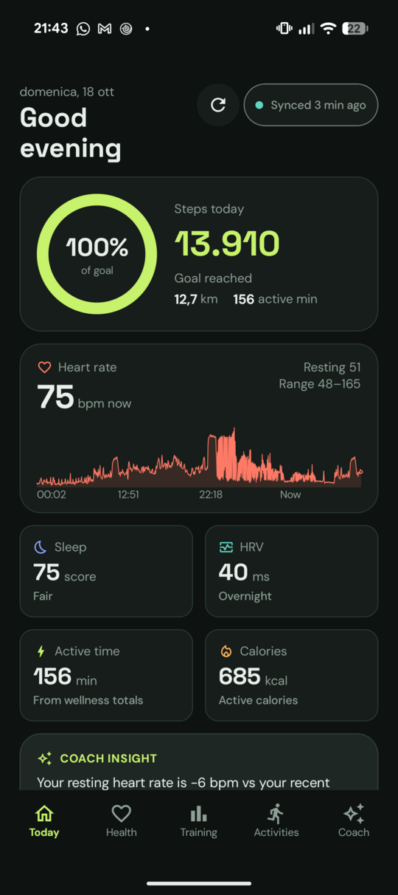
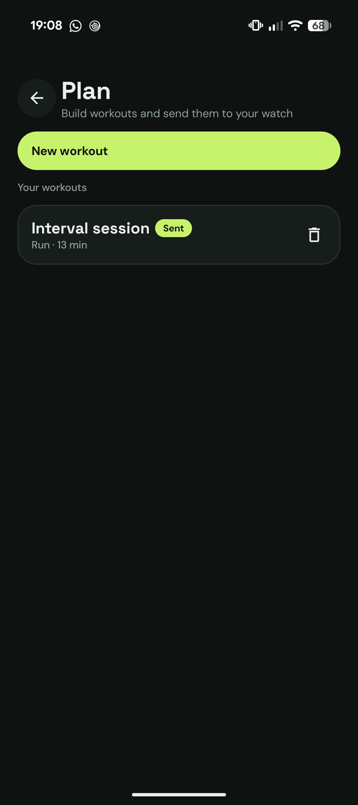
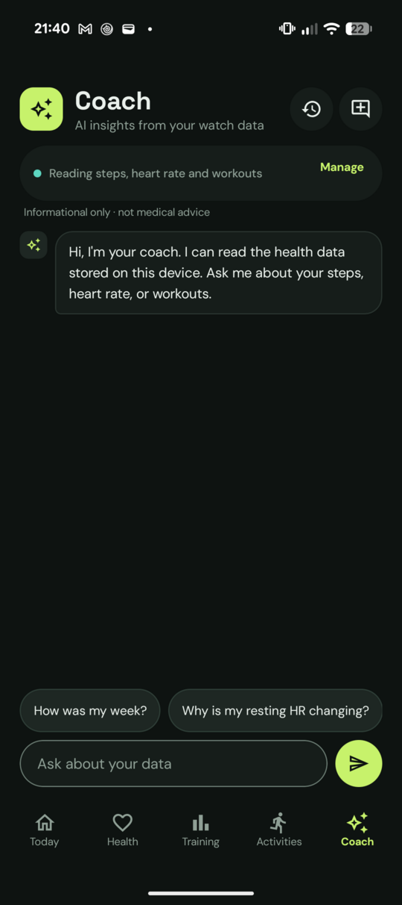
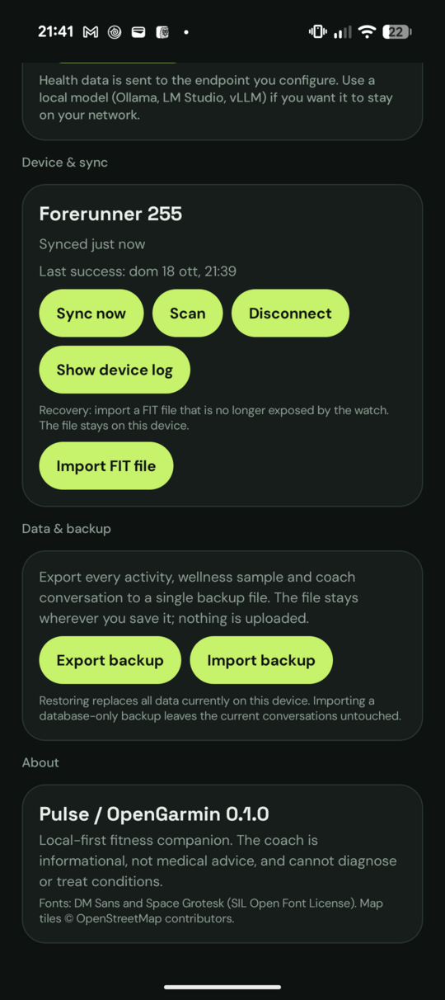

# OpenGarmin — offline, self-hosted companion for Garmin watches

A clean-room, local-first replacement for the Garmin Connect mobile app. It talks
directly to your watch over Bluetooth LE, pulls your data, and stores it **only on
your device**. No Garmin account, no cloud, no telemetry.

This repository started as a reverse-engineering study of the official
`com.garmin.android.apps.connectmobile` APK (v5.19.1). The recovered protocol is
documented in [`docs/PROTOCOL.md`](docs/PROTOCOL.md) and re-implemented from
scratch in the `protocol/` module.

> **Status:** working local pipeline. BLE/GFDI sync, FIT + wellness ingestion,
> the five-tab Pulse UI (Today, Health, Training, Activities, Coach), an
> OpenAI-compatible AI coach with multi-conversation history, local database
> backup/restore, per-activity FIT/GPX/TCX/CSV export, optional WorkManager
> background sync, and PacePro strategy building with on-phone run guidance are
> implemented. All health data comes from the watch's own FIT files; no Garmin
> Connect account or REST API is used. See
> [`BACKLOG.md`](BACKLOG.md) for remaining data-coverage items and
> [`docs/HANDOFF.md`](docs/HANDOFF.md) for the protocol notes.

## Download

Installable APKs are published on the [**Releases**](https://github.com/naddi96/opengarmin/releases)
page; the newest build is always at
[`releases/latest`](https://github.com/naddi96/opengarmin/releases/latest). Every
`v*` tag is built and uploaded automatically by the **Release APK** workflow,
together with a SHA-256 checksum.

The APK is signed with the project release key
(`keystore/opengarmin-release.jks`), so newer releases install over older ones.
Because that key is public, treat GitHub builds as a convenience and build from
source if you need a stronger trust guarantee.

```bash
adb install -r OpenGarmin-0.1.0.apk
```

To publish a release, tag the commit and push the tag:

```bash
git tag v0.1.1
git push origin v0.1.1
```

You can also run the **Release APK** workflow from the Actions tab and enter a
version such as `v0.1.1`.

## Why

The official app is a thin client for Garmin's servers; it does not keep your data
locally. This project reverses that: the watch is the source of truth, your phone is
the archive.

## Screens

| Today | Plan | Coach | Data & backup |
|:---:|:---:|:---:|:---:|
|  |  |  |  |
| Steps, heart rate, sleep/HRV, Body Battery and daily insight | Timed/distance steps, repeat blocks and direct watch upload | Streaming coach with typed local-health tools and conversation history | Export or restore the database and coach conversations |

## Target devices

Developed against the **Garmin Forerunner** family (245 / 255 / 955 / 965), which use
the **GFDI v2 / Multi-Link** BLE protocol. The same stack is used by Fenix 5+/6/7,
Venu/Venu 2/3, Instinct 2 and others, with small differences.

## Features

- **Background sync:** optional periodic sync through Android WorkManager
  (15 min–6 h, default 60 min and off) with battery-not-low and optional
  charging constraints. A process-wide lease keeps the worker, foreground sync,
  and manual taps from opening competing BLE transfers. Transient failures retry
  with exponential backoff; permanent setup problems surface an action. Last
  attempt/success, duration, trigger, and result are stored locally. See
  [`docs/background-sync.md`](docs/background-sync.md).
- **Today:** steps ring and goal, resting/current heart rate with an intraday
  chart, active time, calories, and explicit empty states for not-yet-ingested
  sleep/HRV.
- **Health:** real Body Battery (stress-topic field 3), stress distribution,
  SpO₂, respiration, resting HR, movement, weekly active minutes, and sleep/HRV
  cards that populate when the watch exposes its SLEEP_DATA/HRV files.
- **Training:** recovery time, VO₂ max and six-week trend, 7-day acute load and
  load focus, lactate threshold, performance condition, and the latest training
  effect, all decoded from the watch's `activity_metrics`/`user_metrics` FIT
  messages.
- **PacePro:** build a race strategy from a 5K, 10K, half, marathon or custom
  distance goal, optionally using the elevation profile of a recent GPS run.
  Split strategy and hill-effort sliders recalculate every split; the preview
  shows target pace, elapsed time and climb per split. **Accept and send to
  watch** writes a `FIT_TYPE_56` pace-band file directly over BLE. **Preview
  run** is a live on-phone pacing screen with GPS distance, current/overall pace
  versus target, split status, finish estimate, elevation and manual laps.
  Watch upload was verified on a Forerunner 255; live HR still needs the watch's
  Broadcast Heart Rate mode.
- **Plan:** build workouts from timed, distance or open steps and repeat blocks,
  save drafts, schedule sessions, or ask the coach to create one; push the
  generated FIT workout directly to the watch's Workouts menu over BLE. No
  Garmin account or workout-service round trip is involved.
- **Trends:** selectable 7-day, 30-day, 90-day, 1-year, all-time or custom
  date ranges; per-metric charts and averages for steps, sleep, HRV, resting
  HR, active minutes, calories, stress, SpO₂, respiration and Body Battery;
  daily/weekly/monthly buckets with partial-history labels (never zero-filled).
  Reachable from the Health header.
- **Recovery:** Settings → **Import FIT file** imports a local FIT activity that the watch no longer exposes, without using Garmin Connect or any API.
- **Backup:** Settings → **Export backup** writes a single ZIP with a consistent
  snapshot of the local database (activities, records, laps, FIT messages and
  wellness data) plus the coach conversation history. **Import backup** validates
  the archive and schema version, then replaces the local data; a raw SQLite
  database exported earlier is also accepted. Provider settings and API keys are
  not included. The archive is unencrypted, so store it somewhere you trust.
- **Activities:** weekly summary, sport filters (Run, Ride, Cardio, Strength,
  Walk, and an Other bucket for every remaining sport), row-to-featured
  selection, real GPS/HR trace, heart-rate zone bar, full activity detail with
  map, HR/elevation charts, laps, local FIT/GPX/TCX/CSV export, and the FIT data
  explorer. Export uses the system document picker, copies the original FIT file
  when it is still on disk, and never uploads anything. See
  [`docs/export.md`](docs/export.md) for the format and CSV-column reference.
- **Coach:** OpenAI-compatible provider presets (OpenAI, DeepSeek, OpenRouter,
  Ollama, LM Studio, vLLM, Custom), encrypted API keys, model management,
  connection test, streaming Markdown chat with cancel, typed read-only health
  tools, coach-authored workout plans saved to the Plan tab, code-generated
  evidence chips, and inline trend/activity charts (including overlaid
  multi-workout comparisons). Conversation history keeps up to 50 chats locally;
  reopen or delete old conversations from the Coach header.
- **Local-first:** no account, backend, telemetry, or cloud copy.

## Documentation

- [`docs/architecture-notes.md`](docs/architecture-notes.md) — current stack,
  data model, storage, backup/restore, ingestion, and coverage gaps.
- [`docs/garmin-connect-gap-analysis.md`](docs/garmin-connect-gap-analysis.md) —
  comparison with Garmin Connect, prioritized missing features, deliberate
  non-goals, and differentiator proposals.
- [`docs/design/tokens.md`](docs/design/tokens.md) — design tokens; mockups are
  in [`docs/design/mockups/`](docs/design/mockups/).
- [`docs/providers.md`](docs/providers.md) — provider setup, presets, env config,
  keys, cleartext policy, streaming and troubleshooting.
- [`docs/tools.md`](docs/tools.md) — coach tools, limits, evidence, conversation
  history, safety, and how to add a tool.
- [`docs/testing.md`](docs/testing.md) — test commands and the manual device
  matrix, including backup/restore and conversation history.
- [`docs/export.md`](docs/export.md) — per-activity FIT/GPX/TCX/CSV export,
  filename rules, CSV columns, and local-only handling.
- [`docs/background-sync.md`](docs/background-sync.md) — periodic sync settings,
  constraints, single-flight, retries, notifications, and Android lifecycle.
- [`docs/privacy.md`](docs/privacy.md) — what leaves the device, key/log
  handling, backups, exports, and data deletion.
- [`docs/HANDOFF.md`](docs/HANDOFF.md) — protocol findings and chronological
  implementation notes.
- [`docs/PLAN.md`](docs/PLAN.md) — layering, milestones, and remaining work.
- [`BACKLOG.md`](BACKLOG.md) — epics, stories, status, and open questions.

## Architecture

```
 ┌──────────┐   BLE (GFDI / Multi-Link)   ┌────────────────────────────┐
 │  Watch   │ ◀────────────────────────▶  │  Android app (this repo)   │
 └──────────┘                             │  ┌──────────────────────┐  │
                                          │  │ protocol/ (pure JVM) │  │
                                          │  │  COBS · CRC16 · ML   │  │
                                          │  └──────────────────────┘  │
                                          │  ┌──────────────────────┐  │
                                          │  │ FIT parser + Room DB │  │
                                          │  └──────────────────────┘  │
                                          │  ┌──────────────────────┐  │
                                          │  │ Compose UI + coach   │  │
                                          │  └──────────────────────┘  │
                                          └────────────────────────────┘
                                              │                 │
                              local DB/files  │                 │ optional HTTPS
                              + ZIP backup     ▼                 ▼
                                        on-device storage   configured LLM endpoint
```

## Modules

| Module | Type | Purpose |
|---|---|---|
| `protocol` | Kotlin/JVM library | Wire protocol: GFDI framing, CRC-16, COBS, Multi-Link handles, handshake. No Android deps → fully unit-testable. |
| `app` | Android app | BLE I/O, sync engine, FIT ingestion, Room database, Compose UI, provider/client/tool/chat layer, conversation history, and database backup/restore. |

## Build

Requires a JDK 17+ and the Android SDK for the `app` module. The `protocol`
module builds with plain Gradle:

```bash
# unit tests for the protocol core
./gradlew :protocol:test

# build the Android app (needs ANDROID_HOME / local.properties)
./gradlew :app:assembleDebug
```

`tools/` contains helper scripts used during the original investigation
(APK extraction, smali decompilation, user-space toolchain install). They are not
required to build the app.

## Licensing

The wire-protocol *facts* here were recovered for interoperability. Several existing
projects (Gadgetbridge, garmin-bridge) are **AGPL-3.0**; this repository re-implements
the protocol independently and is licensed as **AGPL-3.0** to remain compatible with
that ecosystem. See [`docs/LICENSING.md`](docs/LICENSING.md).
