# OpenGarmin

**An offline, local-first companion for Garmin watches.**

OpenGarmin talks directly to your watch over Bluetooth LE, imports the watch's own
FIT files, and presents them in a fast Android app. There is no Garmin Connect
account, no cloud backend, and no telemetry: your health data stays on your phone.

[](https://github.com/naddi96/opengarmin/actions/workflows/android.yml)
[](https://github.com/naddi96/opengarmin/releases/latest)
[](LICENSE)
[](#build-from-source)
[](#build-from-source)

The BLE protocol was recovered for interoperability from Garmin Connect Mobile
5.19.1 and re-implemented from scratch in the pure-JVM [`protocol`](protocol)
module. The recovered wire format is documented in
[`docs/PROTOCOL.md`](docs/PROTOCOL.md); implementation notes are in
[`docs/HANDOFF.md`](docs/HANDOFF.md).

## Contents

- [Screens](#screens)
- [Quick start](#quick-start)
- [Features](#features)
- [How it works](#how-it-works)
- [Supported devices](#supported-devices)
- [Build from source](#build-from-source)
- [Project structure](#project-structure)
- [Privacy and security](#privacy-and-security)
- [Documentation](#documentation)
- [Status and limitations](#status-and-limitations)
- [Contributing](#contributing)
- [License](#license)

## Screens

The app shell is called **Pulse**. Five tabs cover daily activity, wellness,
training, recorded workouts, and the optional AI coach. Focused screens provide
activity analysis, trends, planning, pacing, data inspection, and settings.

| Today | Health | Training |
|:---:|:---:|:---:|
| [](docs/screenshots/today.png) | [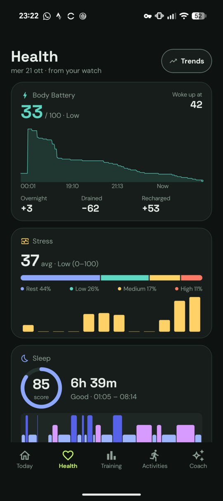](docs/screenshots/health.png) | [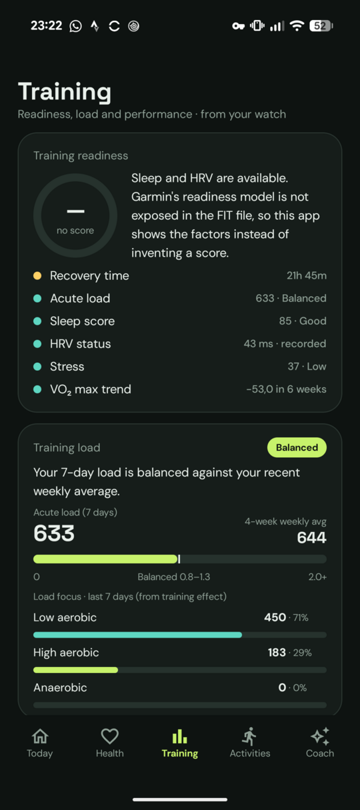](docs/screenshots/training.png) |
| **Today** — steps ring, heart rate, sleep, HRV, active time, calories and a daily coach insight. | **Health** — Body Battery, stress distribution, sleep stages, SpO₂, respiration and recovery signals. | **Training** — readiness factors, acute load, load focus, VO₂ max, lactate threshold and race predictions. |

| Activities | Activity detail | Activity charts |
|:---:|:---:|:---:|
| [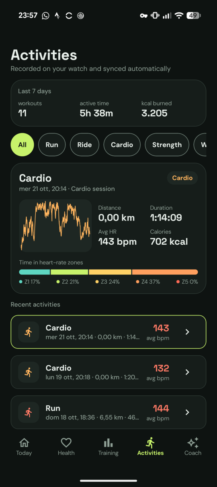](docs/screenshots/activities.png) | [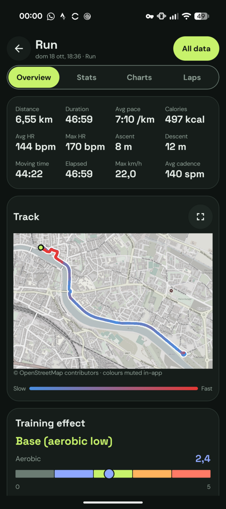](docs/screenshots/activity-detail.png) | [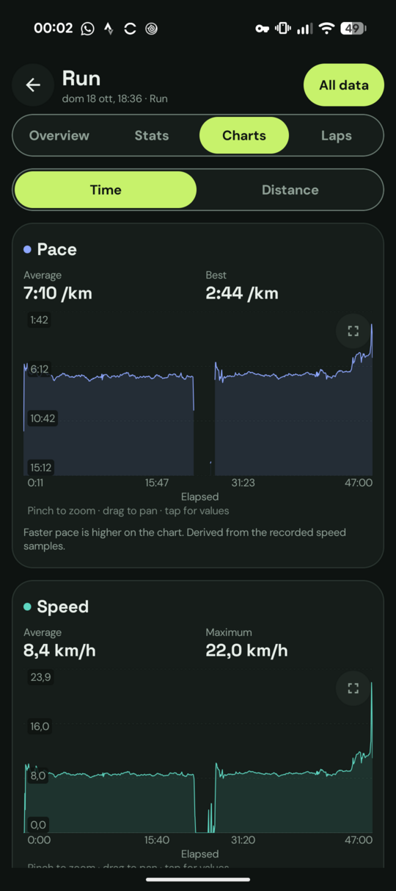](docs/screenshots/activity-charts.png) |
| **Activities** — weekly totals, sport filters, featured activity, heart-rate preview and zones. | **Activity detail** — Garmin-style Overview, Stats, Charts and Laps tabs, plus local FIT/GPX/TCX/CSV export. | **Charts** — pinch-zoom, pan and tap-to-inspect graphs for time or distance. |

| Trends | Coach | Plan |
|:---:|:---:|:---:|
| [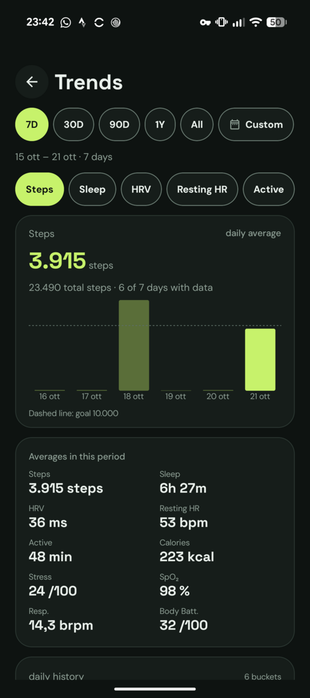](docs/screenshots/trends.png) | [](docs/screenshots/coach.png) | [](docs/screenshots/plan.png) |
| **Trends** — 7-day, 30-day, 90-day, 1-year, all-time and custom ranges with honest partial-history labels. | **Coach** — streaming AI chat with typed read-only health tools, evidence chips, charts and local conversation history. | **Plan** — timed, distance and open steps; repeat blocks; scheduling; direct FIT workout upload to the watch. |

| PacePro strategy | PacePro preview | FIT data explorer |
|:---:|:---:|:---:|
| [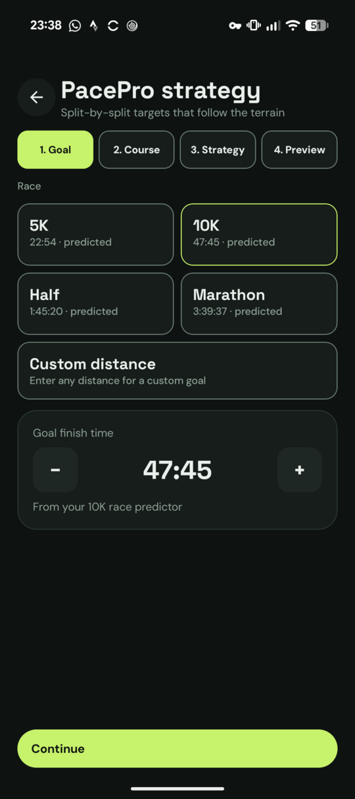](docs/screenshots/pacepro.png) | [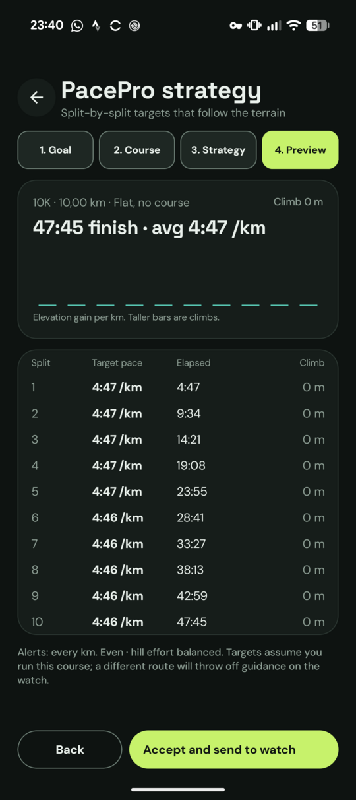](docs/screenshots/pacepro-preview.png) | [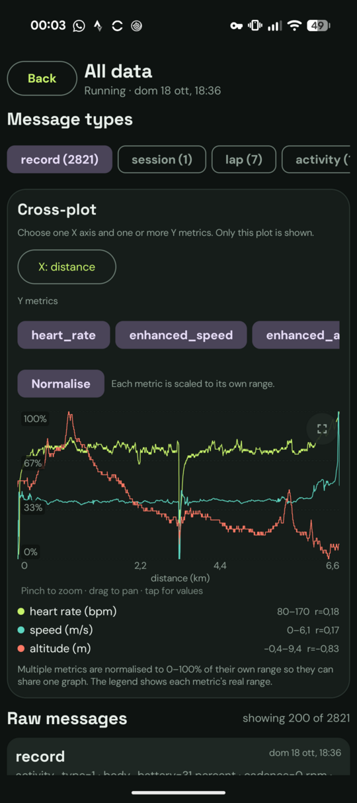](docs/screenshots/data-explorer.png) |
| **PacePro strategy** — race or custom distance, optional GPS course, split and hill-effort strategy. | **PacePro preview** — per-split target pace, elapsed time and climb, with watch upload. | **FIT explorer** — every decoded message and field, with cross-plots and raw message inspection. |

| Settings & backup | Provider settings |
|:---:|:---:|
| [](docs/screenshots/backup-settings.png) | [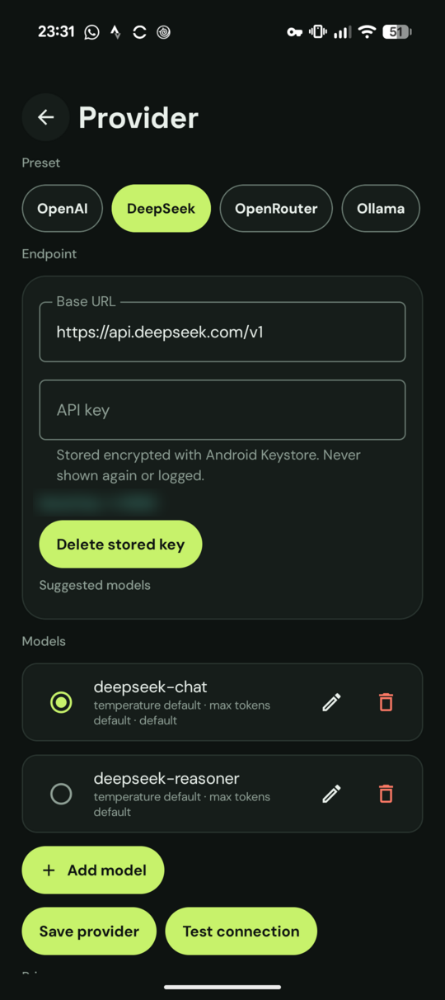](docs/screenshots/provider.png) |
| **Settings** — profile, device sync, background sync, FIT import, backup/restore and about. | **Provider settings** — OpenAI-compatible presets, encrypted API keys, model management and connection test. |

### More screens

| PacePro run | Conversation history | Device log |
|:---:|:---:|:---:|
| [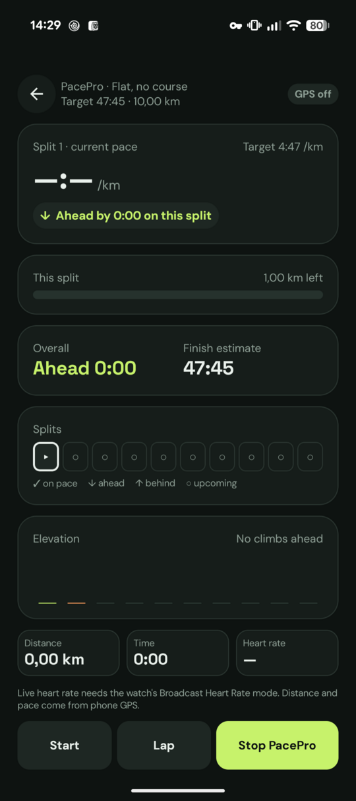](docs/screenshots/pace-run.png) | [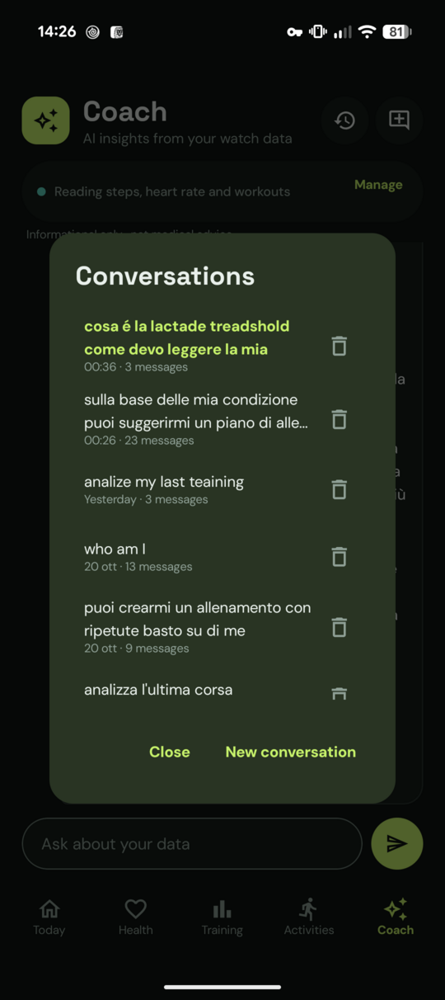](docs/screenshots/coach-history.png) | [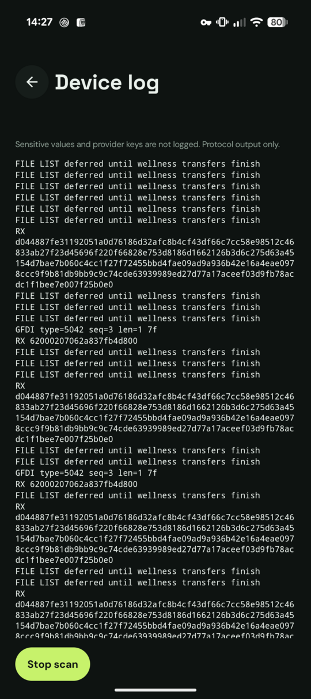](docs/screenshots/device-log.png) |
| **PacePro run** — live split progress, overall target, elevation, finish estimate and manual laps. | **Conversation history** — reopen or delete up to 50 locally stored coach chats. | **Device log** — redacted GFDI/Multi-Link protocol output for diagnostics. |

## Quick start

1. Download the latest APK from the [**Releases**](https://github.com/naddi96/opengarmin/releases/latest) page.
2. Pair the watch in Android's Bluetooth settings. OpenGarmin uses the OS bond and
   the standard Garmin Multi-Link service.
3. Open the app, grant Bluetooth and notification permissions, then tap **Sync**.

Install from a terminal with:

```bash
adb install -r OpenGarmin-0.1.0.apk
```

The APK is signed with the project release key
(`keystore/opengarmin-release.jks`), so newer builds install over older ones.
That key is public: use the GitHub builds for convenience, or build from source if
you need a stronger trust guarantee.

### Publishing a release

Every `v*` tag builds and uploads a signed APK plus a SHA-256 checksum through the
**Release APK** workflow:

```bash
git tag v0.1.1
git push origin v0.1.1
```

You can also run the workflow manually from the Actions tab and supply a version.

## Features

### Sync and connectivity

- Direct BLE sync over the watch's GFDI / Multi-Link protocol; no Garmin account
  or REST API is involved.
- Manual sync, sync-on-launch, reconnect-triggered sync, and optional periodic
  sync through Android WorkManager (15 min–6 h; off by default).
- Battery-not-low and optional charging constraints, plus a process-wide lease so
  foreground sync, background sync and manual taps never open competing BLE
  transfers.
- Automatic recovery from stalled sessions, honest failure states, and a
  private-visibility progress notification with activity index, file size and
  last imported activity.

### Health and wellness

- Steps and goal progress, current/resting heart rate with an intraday chart,
  active minutes and calories.
- Body Battery (stress-topic field 3), stress distribution, SpO₂, respiration,
  resting heart rate, movement and weekly active minutes.
- Sleep score/stages and overnight HRV, populated only when the watch exposes its
  SLEEP_DATA and HRV files; missing data is shown as an empty state, never as a
  fabricated value.
- Selectable 7-day, 30-day, 90-day, 1-year, all-time or custom trend ranges with
  per-metric charts, averages and partial-history labels.

### Training and activities

- Recovery time, VO₂ max and six-week trend, 7-day acute load and load focus,
  lactate threshold, performance condition and latest training effect, decoded
  from the watch's `activity_metrics` / `user_metrics` FIT messages.
- Weekly activity summary and sport filters (Run, Ride, Cardio, Strength, Walk and
  an Other bucket), row-to-featured selection, GPS route with a speed-coloured
  track, and a heart-rate zone bar.
- Full activity detail with Overview, Stats, Charts and Laps tabs; pace/speed,
  moving time, run/walk detection, heart rate, training effect, power, running
  dynamics, elevation, calories, Body Battery and watch zone breakdowns.
- Interactive, colour-coded charts with pinch-zoom, pan and tap-to-inspect values,
  switchable between time and distance axes.
- Per-activity export to FIT, GPX, TCX or CSV through the system document picker.
  The original FIT file is copied when it is still on disk; nothing is uploaded.
  See [`docs/export.md`](docs/export.md).

### Planning, pacing and the coach

- **Plan:** build workouts from timed, distance or open steps and repeat blocks,
  save drafts, schedule sessions, and push generated FIT workouts directly to the
  watch over BLE.
- **PacePro:** create a strategy for 5K, 10K, half, marathon or a custom distance,
  optionally using a recent GPS run's elevation profile. Split and hill-effort
  sliders recalculate every split; **Accept and send to watch** writes a
  `FIT_TYPE_56` pace-band file over BLE.
- **PacePro run:** live on-phone pacing with GPS distance, current/overall pace
  versus target, split status, finish estimate, elevation and manual laps. Live
  heart rate requires the watch's Broadcast Heart Rate mode.
- **Coach:** OpenAI-compatible provider presets (OpenAI, DeepSeek, OpenRouter,
  Ollama, LM Studio, vLLM, Custom), Keystore-encrypted keys, model management,
  connection test, streaming Markdown chat with cancel, typed read-only health
  tools, coach-authored workout plans, evidence chips and inline charts.
- Up to 50 locally stored conversations, reopenable or deletable from the Coach
  header.

### Data ownership

- **Local-first:** no account, backend, telemetry, analytics, or cloud copy.
- **Backup:** export a single ZIP with a consistent snapshot of the Room database
  and coach conversations. Import validates the archive and schema before
  replacing local data; older raw SQLite exports are accepted.
- **Recovery:** import a local FIT activity the watch no longer exposes, without
  Garmin Connect or any API.
- **Profile:** step goal, max heart rate, height, weight, optional birth year,
  biological sex and training limitations. The profile is sent to the coach only
  during chat so advice can account for body size and constraints.

## How it works

```
┌──────────────┐         BLE · GFDI / Multi-Link         ┌──────────────────────────────┐
│ Garmin watch │ ◀─────────────────────────────────────▶ │ Android app                  │
│  FIT files   │                                         │                              │
└──────────────┘                                         │  protocol/ · pure Kotlin/JVM │
                                                         │   COBS · CRC-16 · GFDI · ML  │
                                                         │  ──────────────────────────  │
                                                         │  BLE client · sync engine    │
                                                         │  FIT parser · Room database  │
                                                         │  Compose UI · coach tools    │
                                                         └──────────────┬───────────────┘
                                                                        │
                                              on-device storage ◀───────┴───────▶ optional HTTPS
                                              DB · FIT files · backups           your LLM endpoint
```

1. The watch advertises the Garmin Multi-Link service; the app connects over GATT
   and performs the GFDI/GDI handshake.
2. The sync engine enumerates available files, downloads activities and wellness
   data, and imports each FIT file into Room.
3. Compose screens read from Room and local settings; charts and aggregates are
   computed on the phone.
4. If a coach provider is configured, chat requests go directly to that endpoint.
   No request is made to OpenGarmin servers.

## Supported devices

| Device family | Protocol | Notes |
|---|---|---|
| **Forerunner 245 / 255 / 955 / 965** | GFDI v2 / Multi-Link | Primary development target. Watch uploads were verified on a Forerunner 255. |
| **Fenix 5+ / 6 / 7, Venu / Venu 2 / 3, Instinct 2, and similar** | Same stack | Expected to work, with small per-device protocol and file differences. |

Requires an Android 9+ phone with Bluetooth LE and the watch bonded in Android's
Bluetooth settings.

## Build from source

**Prerequisites**

- JDK 17
- Android SDK with platform 34 (`compileSdk`/`targetSdk` 34; `minSdk` 28)
- `ANDROID_HOME` or `local.properties` with `sdk.dir`
- The Gradle wrapper is included; no separate Gradle install is needed.

```bash
# Pure-JVM protocol tests
./gradlew :protocol:test

# App JVM unit and integration tests
./gradlew :app:testDebugUnitTest

# Debug APK
./gradlew :app:assembleDebug

# Optional: instrumented Keystore test (requires a device or emulator)
./gradlew :app:connectedDebugAndroidTest
```

The debug APK is written to `app/build/outputs/apk/debug/app-debug.apk`.

The release workflow builds `:app:assembleRelease` with the public project key and
publishes `OpenGarmin-<version>.apk` plus a `.sha256` file. To sign with your own
key, provide `RELEASE_STORE_FILE`, `RELEASE_STORE_PASSWORD`, `RELEASE_KEY_ALIAS`
and `RELEASE_KEY_PASSWORD`.

## Project structure

| Path | Purpose |
|---|---|
| [`protocol/`](protocol) | Pure Kotlin/JVM wire protocol: GFDI framing, CRC-16, COBS, Multi-Link handles, GDI file access, FIT parsing, and workout/pace-band encoders. No Android dependencies. |
| [`app/`](app) | Android application: BLE I/O, sync engine, FIT ingestion, Room database, Compose UI, provider/client/tool/chat layer and backup/restore. |
| [`docs/`](docs) | Protocol notes, architecture, design tokens and mockups, provider/tool/export/background-sync guides, privacy and testing notes. |
| [`tools/`](tools) | Helper scripts from the original protocol investigation (APK extraction, decompilation, toolchain setup). Not required to build the app. |
| [`keystore/`](keystore) | Public release signing key used by the release workflow. |

```text
protocol/     GFDI · GDI · Multi-Link · FIT codecs
app/
  ble/        GATT connection, MTU, write queue
  sync/       coordinator, foreground service, WorkManager, notifications
  data/       Room entities/DAOs, FIT exporters, backup, wellness parsing
  coach/      chat loop, tools, charts, conversation store
  llm/        OpenAI-compatible client and provider store
  ui/         Pulse shell, screens, components and theme
  settings/   profile and sync settings
```

## Privacy and security

OpenGarmin is designed around a simple rule: **health data belongs on your device.**

- No Garmin account, OpenGarmin backend, telemetry or analytics.
- Watch data, FIT files and derived metrics stay in app-private storage.
- The coach is optional. When used, your message, recent chat history, compact
  tool results and the optional profile are sent to the endpoint **you** configure.
  Local models (Ollama, LM Studio, vLLM) keep processing on your device or LAN.
- API keys are encrypted at rest with Android Keystore AES-GCM, never returned in
  plaintext to the UI, and never written to logs or chat history.
- The device log contains protocol lines only; payloads, keys, HTTP bodies and
  chat content are redacted.
- Backups are written only where you choose, but the ZIP is **not encrypted**.
  Treat it as sensitive health data.

Read [`docs/privacy.md`](docs/privacy.md) for the full data-flow and deletion
details.

## Documentation

| Document | Contents |
|---|---|
| [`docs/architecture-notes.md`](docs/architecture-notes.md) | Current stack, data model, storage, ingestion, backup/restore and coverage gaps. |
| [`docs/PROTOCOL.md`](docs/PROTOCOL.md) | Recovered GFDI/GDI/Multi-Link wire format. |
| [`docs/HANDOFF.md`](docs/HANDOFF.md) | Protocol findings and chronological implementation notes. |
| [`docs/garmin-connect-gap-analysis.md`](docs/garmin-connect-gap-analysis.md) | Comparison with Garmin Connect, missing features, non-goals and differentiators. |
| [`docs/providers.md`](docs/providers.md) | Provider setup, presets, environment config, keys, streaming and troubleshooting. |
| [`docs/tools.md`](docs/tools.md) | Coach tools, limits, evidence, conversation history, safety and how to add a tool. |
| [`docs/export.md`](docs/export.md) | FIT/GPX/TCX/CSV export rules, filenames and CSV columns. |
| [`docs/background-sync.md`](docs/background-sync.md) | Periodic sync settings, constraints, single-flight, retries and Android lifecycle. |
| [`docs/privacy.md`](docs/privacy.md) | What leaves the device, key/log handling, backups, exports and deletion. |
| [`docs/testing.md`](docs/testing.md) | Test commands and the manual device matrix. |
| [`docs/design/tokens.md`](docs/design/tokens.md) | Pulse design tokens; mockups live in [`docs/design/mockups/`](docs/design/mockups/). |
| [`docs/PLAN.md`](docs/PLAN.md) | Layering, milestones and remaining work. |
| [`BACKLOG.md`](BACKLOG.md) | Epics, stories, status and open questions. |

## Status and limitations

The local pipeline is working: BLE/GFDI sync, FIT and wellness ingestion, the
five-tab Pulse UI, activity analysis and export, workout planning, PacePro,
backup/restore, optional background sync and the OpenAI-compatible coach are
implemented. The project is still under active development; remaining
data-coverage work and quality items are tracked in [`BACKLOG.md`](BACKLOG.md).

Known limitations:

- The BLE stack is validated primarily against a Forerunner 255. Other watches
  use the same protocol family but may need small adjustments.
- Garmin's readiness score is not exposed in the watch's FIT files. OpenGarmin
  shows the contributing factors instead of inventing a score.
- Live heart rate during a PacePro run requires the watch's Broadcast Heart Rate
  mode.
- There is no Garmin Connect import or cloud sync by design; the watch and local
  backups are the sources of truth.
- The release signing key is public for reproducible CI builds. Build from source
  if you require a private trust chain.

## Contributing

Issues and pull requests are welcome. Before submitting a change:

1. Build and run the relevant tests (`:protocol:test`, `:app:testDebugUnitTest`).
2. Keep the local-first model: no hidden network calls, no fake or hardcoded data,
   and no new backend dependency without discussion.
3. Handle loading, empty and error states; keep touch targets and text contrast
   accessible.
4. Update the relevant docs and [`BACKLOG.md`](BACKLOG.md) status.
5. Keep commits focused and describe the user-visible change.

## License

OpenGarmin is licensed under the **GNU Affero General Public License v3.0**
(AGPL-3.0). See [`LICENSE`](LICENSE) and [`docs/LICENSING.md`](docs/LICENSING.md).

The wire-protocol facts in this repository were recovered for interoperability.
The implementation is independent; no code from the official app or from
AGPL-licensed prior-art projects is copied. Garmin, Forerunner, Fenix, Venu and
Instinct are trademarks of Garmin Ltd. This project is not affiliated with or
endorsed by Garmin.
